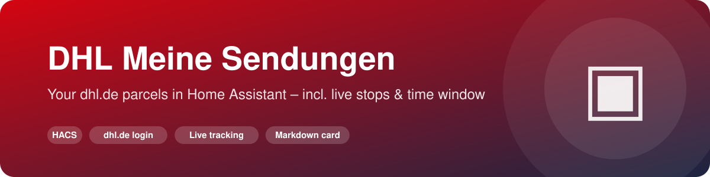
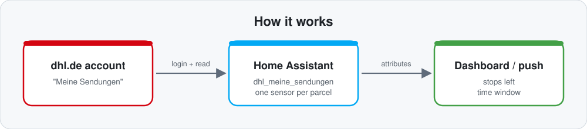
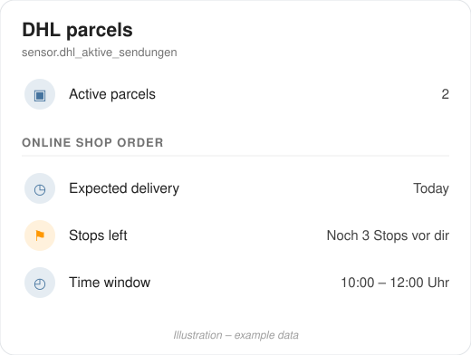

# DHL Meine Sendungen 📦

[English](README.md) · **Deutsch**

[](https://github.com/hacs/integration)
[](https://github.com/dr-apple/my-dhl-for-home-assistant/releases)
[](LICENSE)



Home-Assistant-Integration – meldet sich bei **dhl.de** an und liest alle Sendungen aus „Meine Sendungen“ inklusive Live-Status (Stopps, Zeitfenster, Fahrerposition).



---

## Installation über HACS

### Schritt 1 – HACS-Repository hinzufügen

1. HACS öffnen → **Integrationen**
2. Oben rechts **⋮ → Benutzerdefinierte Repositories**
3. URL eingeben:
   ```
   https://github.com/dr-apple/my-dhl-for-home-assistant
   ```
4. Kategorie: **Integration** → **Hinzufügen**

### Schritt 2 – Integration installieren

1. In HACS nach **„DHL Meine Sendungen“** suchen
2. **Herunterladen** klicken
3. Home Assistant neu starten

### Schritt 3 – Integration einrichten

1. **Einstellungen → Geräte & Dienste → + Integration hinzufügen**
2. Nach **„DHL Meine Sendungen“** suchen
3. DHL-Zugangsdaten (E-Mail + Passwort von dhl.de) eingeben
4. ✅ Fertig – Sendungen erscheinen automatisch als Sensoren

Das Abrufintervall (Standard 30 Minuten) lässt sich unter **Konfigurieren** ändern.

---

## Verfügbare Entitäten



*Illustration – Beispieldaten.*

### Übersichtssensor
**`sensor.dhl_aktive_sendungen`**
- Zustand: Anzahl aktiver Sendungen
- Attribute: `sendungen` (Liste), `gesamt`, `aktiv`

### Sendungssensoren (automatisch pro Paket)
**`sensor.dhl_sendung_…XXXXXX`**

| Attribut | Beschreibung |
|---|---|
| `tracking_number` | Vollständige Sendungsnummer |
| `beschreibung` | Absender / Sendungsbeschreibung |
| `voraussichtliche_lieferung` | Voraussichtliches Datum |
| `live_tracking` | `true`, wenn der Live-Status aktiv ist |
| `stops_noch` | Verbleibende Stopps (live) |
| `stops_noch_text` | „Noch 3 Stops vor dir“ |
| `lieferzeitfenster` | „10:00 – 12:00 Uhr“ |
| `fahrer_position` | Aktuelle Fahrerposition |
| `ereignisse` | Letzte 10 Sendungsereignisse |
| `tracking_url` | Direktlink zu dhl.de |

---

## Lovelace-Karte

```yaml
type: markdown
title: 📦 DHL Sendungen
content: >
  
  
    
  ---
  **{{ s.beschreibung or s.tracking_number }}**
  📍 `{{ s.status_text }}`
      
  🚚 **Noch {{ s.stops_noch }} Stops!**
  ⏰ {{ s.lieferzeitfenster }}
      
  📅 {{ s.voraussichtliche_lieferung }}
      
    
  
  Keine aktiven Sendungen.
  
```

Weitere Karten, Automationen und Template-Sensoren: **[LOVELACE_UND_AUTOMATIONEN.md](LOVELACE_UND_AUTOMATIONEN.md)**

## Beispiel-Automation: „Paket ist gleich da“

```yaml
alias: DHL – Paket kommt gleich
triggers:
  - trigger: template
    value_template: >
      {{ states.sensor
         | selectattr('entity_id', 'search', '^sensor.dhl_sendung_')
         | map(attribute='attributes.stops_noch')
         | select('number') | select('le', 3)
         | list | count > 0 }}
actions:
  - action: notify.mobile_app_mein_handy
    data:
      title: 📦 DHL
      message: Dein Paket ist höchstens noch 3 Stopps entfernt.
```

---

## Bekannte Einschränkungen

- **Zwei-Faktor-Authentifizierung** muss im DHL-Konto ausgeschaltet sein
- **Live-Tracking** gibt es nur am Liefertag, nachdem der Fahrer das Paket eingescannt hat
- DHL kann die Website-Struktur ändern – dann bitte ein [Issue erstellen](https://github.com/dr-apple/my-dhl-for-home-assistant/issues)
- Die Integration liest die Website wie ein Browser; es ist keine offizielle DHL-API

## Fehlersuche

| Problem | Lösung |
|---|---|
| Anmeldung schlägt fehl | Zugangsdaten auf dhl.de im Browser testen; 2FA ausschalten. |
| Keine Sendungen | Erscheinen die Sendungen auf dhl.de unter „Meine Sendungen“? Nur dort hinterlegte Sendungen werden gelesen. |
| Keine Stopps | Live-Daten gibt es erst am Liefertag nach dem Einscannen. |

---

## Lizenz

MIT – siehe [LICENSE](LICENSE). Kein offizielles DHL-Projekt.
