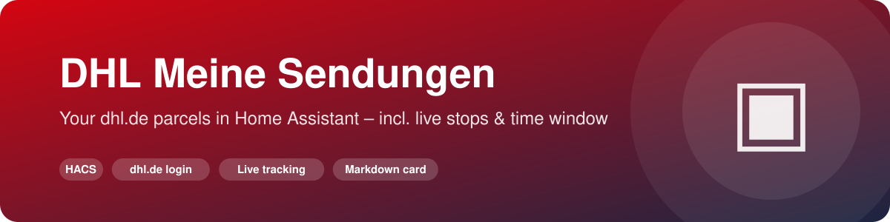
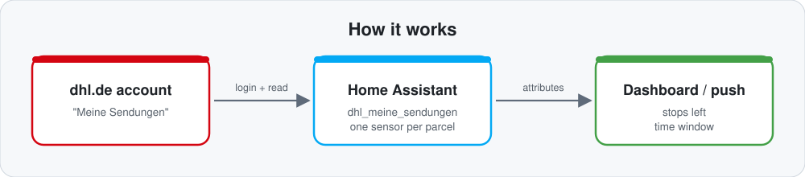
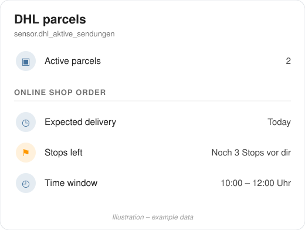

# DHL Meine Sendungen 📦

**English** · [Deutsch](README.de.md)

[](https://github.com/hacs/integration)
[](https://github.com/dr-apple/my-dhl-for-home-assistant/releases)
[](LICENSE)



Home Assistant custom integration that signs in to **dhl.de** and reads all parcels from "Meine Sendungen" (*My shipments*), including the live status (stops left, delivery time window, driver position). Intended for DHL Germany accounts; the integration's texts are German.



---

## Installation via HACS

### Step 1 – add the custom repository

1. Open HACS → **Integrations**
2. Top right **⋮ → Custom repositories**
3. Enter the URL:
   ```
   https://github.com/dr-apple/my-dhl-for-home-assistant
   ```
4. Category: **Integration** → **Add**

### Step 2 – install

1. Search HACS for **"DHL Meine Sendungen"**
2. Click **Download**
3. Restart Home Assistant

### Step 3 – set up

1. **Settings → Devices & services → + Add integration**
2. Search for **"DHL Meine Sendungen"**
3. Enter your DHL credentials (e-mail + password of dhl.de)
4. ✅ Done – parcels appear automatically as sensors

The polling interval (default 30 minutes) can be changed under **Configure**.

---

## Entities



*Illustration – example data.*

### Overview sensor
**`sensor.dhl_aktive_sendungen`** (active parcels)
- State: number of active parcels
- Attributes: `sendungen` (list of parcels), `gesamt` (total), `aktiv` (active)

### Parcel sensors (created automatically per parcel)
**`sensor.dhl_sendung_…XXXXXX`**

| Attribute | Description |
|---|---|
| `tracking_number` | Full tracking number |
| `beschreibung` | Sender / parcel description |
| `voraussichtliche_lieferung` | Expected delivery date |
| `live_tracking` | `true` while live tracking is active |
| `stops_noch` | Stops left (live) |
| `stops_noch_text` | "Noch 3 Stops vor dir" (3 stops before you) |
| `lieferzeitfenster` | Delivery time window, e.g. "10:00 – 12:00 Uhr" |
| `fahrer_position` | Current driver position |
| `ereignisse` | Last 10 tracking events |
| `tracking_url` | Direct link to dhl.de |

---

## Lovelace card

```yaml
type: markdown
title: 📦 DHL parcels
content: >
  
  
    
  ---
  **{{ s.beschreibung or s.tracking_number }}**
  📍 `{{ s.status_text }}`
      
  🚚 **{{ s.stops_noch }} stops left!**
  ⏰ {{ s.lieferzeitfenster }}
      
  📅 {{ s.voraussichtliche_lieferung }}
      
    
  
  No active parcels.
  
```

More cards, automations and template sensors (German): **[LOVELACE_UND_AUTOMATIONEN.md](LOVELACE_UND_AUTOMATIONEN.md)**

## Example automation: "parcel is almost here"

```yaml
alias: DHL – parcel almost here
triggers:
  - trigger: template
    value_template: >
      {{ states.sensor
         | selectattr('entity_id', 'search', '^sensor.dhl_sendung_')
         | map(attribute='attributes.stops_noch')
         | select('number') | select('le', 3)
         | list | count > 0 }}
actions:
  - action: notify.mobile_app_my_phone
    data:
      title: 📦 DHL
      message: Your parcel is 3 stops away or less.
```

---

## Known limitations

- **Two-factor authentication** must be disabled in the DHL account
- **Live tracking** is only available on the delivery day after the driver has scanned the parcel
- DHL may change its website – please [open an issue](https://github.com/dr-apple/my-dhl-for-home-assistant/issues)
- The integration reads the website like a browser; it is not an official DHL API

## Troubleshooting

| Problem | Fix |
|---|---|
| Login fails | Test the credentials on dhl.de in a browser; disable 2FA. |
| No parcels | Do they show up on dhl.de under "Meine Sendungen"? Only parcels listed there are read. |
| No stops | Live data only exists on the delivery day after the parcel was scanned. |

---

## License

MIT – see [LICENSE](LICENSE). Not an official DHL project.
